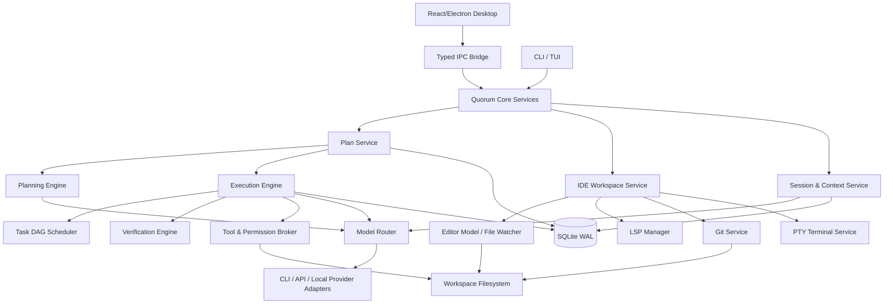
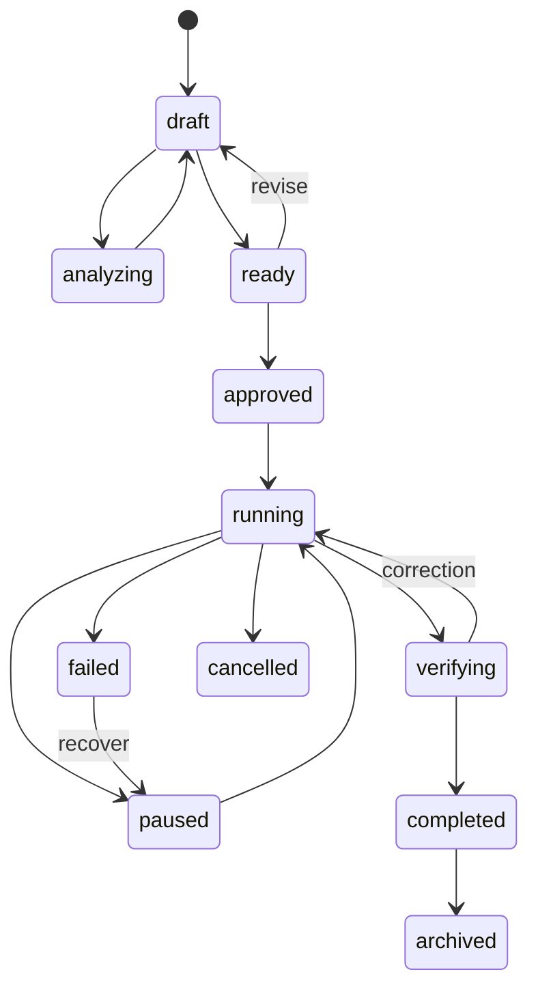
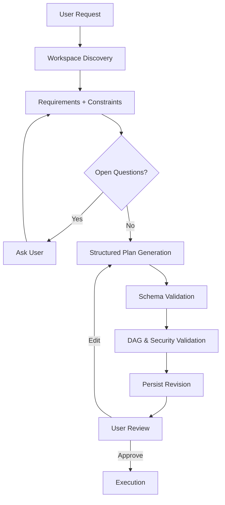
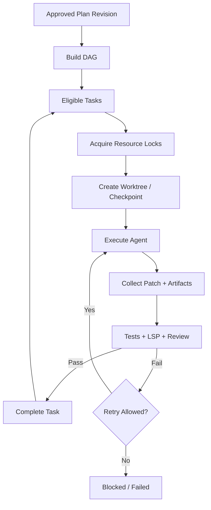
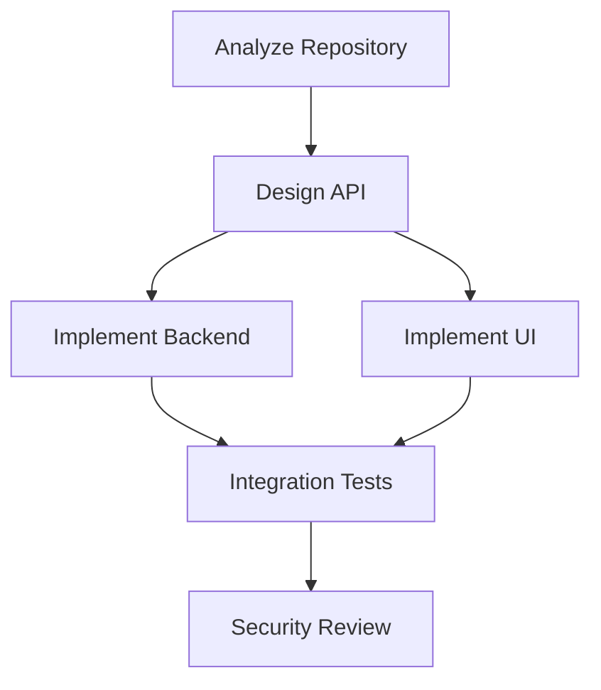
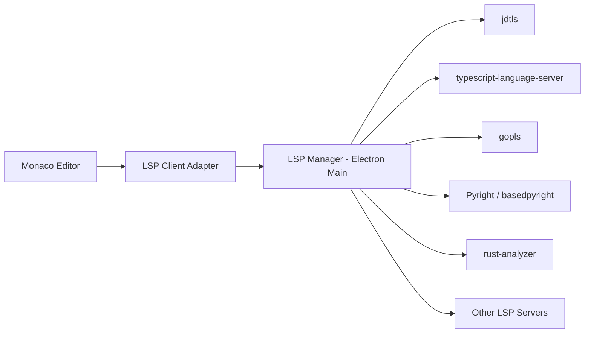

# Quorum – Persistent Plan Mode & AI-powered Mini-IDE

> **Architektur- und Implementierungskonzept** · Version 1.0 · 03.11.2026  
> Ziel: Ein providerunabhängiger, persistenter Planungs- und Entwicklungsworkflow mit KI-gesteuertem Code-Editor, LSP, Git, Tests und Agent-Orchestrierung.

## 1. Vision und Produktprinzipien

Quorum soll mehr als ein Multi-Modell-Chat sein: ein gemeinsamer Workspace für **Ask → Research → Plan → Approve → Execute → Verify → Review**, mit integrierter, schlanker IDE. Unterschiedliche Modelle und CLI-Agenten sollen austauschbar arbeiten können. Desktop, CLI und TUI verwenden dieselbe Kernlogik.

**Leitprinzipien:**

1. **Providerunabhängig:** Plan und Task gehören Quorum, nicht Claude/Codex/Ollama.
2. **Persistenz:** Jede Revision, Ausführung, Freigabe und relevante Aktion übersteht Neustarts.
3. **Sichere Ausführung:** Keine impliziten Schreibrechte; Toolrechte technisch durchsetzen.
4. **Human-in-the-loop:** Nutzer kann jeden Plan und Diff prüfen, ändern und freigeben.
5. **Lokale Kontrolle:** SQLite, lokale Workspaces, transparente Datenflüsse; Cloud nur nach Konfiguration.
6. **IDE statt Chat-Anhang:** Editor, LSP, Git und Agenten teilen dieselben Dateien und Diagnosen.
7. **Nachvollziehbarkeit:** Was wurde geplant, von wem geändert, mit welchem Modell geprüft?

### 1.1 Funktionsumfang

| Bereich | Kernfunktionen | Priorität |
|---|---|---|
| Plan Mode | Strukturierte Pläne, Revisionen, Task-DAG, Rückfragen, Freigaben | P0 |
| Execution | Scheduler, Agenten, Retry, Checkpoints, Recovery | P0/P1 |
| Mini-IDE | Dateibaum, Tabs, Editor, Syntax-Highlighting, Suche | P0 |
| Language Intelligence | LSP, Diagnostics, Hover, Definition, References, Rename | P1 |
| AI Coding | Inline Edit, Explain, Fix, Generate Tests, Diff Review | P1 |
| Git | Status, Diff, Stage, Commit, Worktrees, Konflikte | P1 |
| Developer UX | Command Palette, Split View, Shortcuts, Kontextinspektor | P1/P2 |
| Advanced | Multi-Agent, Smart Routing, Benchmarks, Scheduled Agents | P2/P3 |

---

## 2. Gesamtarchitektur



**Grenzen:** React darf keine direkten privilegierten Dateisystem- oder Shell-Aufrufe ausführen. Electron Main/Core hostet Services; ein eng definierter `contextBridge`-API-Layer vermittelt IPC. CLI/TUI nutzen dieselben Core-Services ohne Renderer-Abhängigkeiten. Remote-Workspaces benötigen einen gesonderten, authentifizierten Agenten/Transport.

### 2.1 Modulverantwortung

- **Plan Service:** CRUD, Revisionen, Validierung, Freigaben, Import/Export.
- **Planning Engine:** Repository-Discovery, Rückfragen, Plan-Generierung, Replanning.
- **Execution Engine:** Ausführungszustände, Scheduling, Checkpoints, Unterbrechung.
- **IDE Workspace Service:** Öffnen, Speichern, Dateibeobachtung, Buffer-Synchronisation.
- **LSP Manager:** Language-Server-Lifecycle und JSON-RPC-Transport.
- **AI Context Builder:** Selektierte Bereiche, Diagnosen, Symbolreferenzen, Git-Diffs, Tokenbudget.
- **Tool Broker:** Permissions, Audit, Sandboxing, Shell/FS/Git/Netzwerk.
- **Model Router:** Fähigkeiten, Verfügbarkeit, Kosten, Fallbacks und Provideradapter.
- **Persistence:** SQLite-Migrationen, transaktionale Writes, Events, Artefakt-Metadaten.

---

## 3. Plan Mode – Betriebsmodi und Zustände

### 3.1 Modi

- **Ask:** Read-only-Konversation, Dateien analysieren, keine Änderungen.
- **Plan:** Repository analysieren, Fragen stellen, strukturierten Plan erzeugen und versionieren; read-only.
- **Agent:** Genehmigte Aufgaben umsetzen und prüfen.
- **Orchestrate:** Mehrere isolierte Agenten koordinieren.
- **Review/Compare:** Ergebnisse mehrerer Modelle oder Revisionen gegenüberstellen.
- **Research:** Quellenbasierte mehrstufige Recherche.

### 3.2 Plan-Zustandsmaschine



**Wichtig:** Planstatus und Ausführungsstatus sind konzeptionell verschieden. `Plan` hält die aktuelle Darstellung, `PlanExecution` den tatsächlichen Run. Ein Plan kann mehrfach ausgeführt werden; ein alter Run bleibt seiner ursprünglichen Revision zugeordnet.

### 3.3 Plan-Lebenszyklus

1. Nutzer beschreibt Ziel und Workspace.
2. Quorum ermittelt relevante Dateien, Technologien, Konventionen und Tests.
3. Quorum sammelt offene Fragen, Annahmen, Constraints und Out-of-Scope.
4. Modell erzeugt strukturierte Plandefinition, kein freies Markdown als einzige Datenquelle.
5. JSON-Schema und DAG-Validator prüfen Referenzen, Zyklen und Pflichtfelder.
6. Entwurf wird als unveränderliche Revision gespeichert.
7. Nutzer bearbeitet Tasks, Reihenfolge, Kriterien und Modellzuweisungen.
8. Genehmigung bindet sich an Revision **und** konkreten Rechteumfang.
9. Scheduler startet zulässige Tasks, gegebenenfalls in getrennten Git-Worktrees.
10. Tests, LSP-Diagnostics und Reviewer validieren Ergebnisse.
11. Nutzer nimmt Diffs an; Quorum dokumentiert Artefakte und Abschlussbericht.

---

## 4. Datenmodell

### 4.1 Entitäten

| Entität | Bedeutung |
|---|---|
| `Plan` | Stabile Identität, Workspace, aktuelle Revision |
| `PlanRevision` | Unveränderliche strukturierte Plandefinition |
| `PlanPhase` | Gruppierung von Tasks |
| `PlanTask` | Aufgabe mit Akzeptanzkriterien und Abhängigkeiten |
| `TaskDependency` | gerichtete Kante zwischen Tasks |
| `PlanQuestion` | Nutzer-Rückfrage, Optionen, Antwort |
| `ModelAssignment` | Rolle, Provider, Modell und Fallback |
| `PlanApproval` | Freigabe einer Revision mit Policy-Scope |
| `PlanExecution` | Ein Ausführungsdurchlauf |
| `TaskExecution` | Taskstatus innerhalb eines Runs |
| `TaskAttempt` | Einzelner Versuch mit Tools, Fehlern und Metriken |
| `ExecutionCheckpoint` | Recovery-Information und Git-Referenzen |
| `PlanArtifact` | Ergebnis, Patch, Bericht oder Testprotokoll |
| `PlanEvent` | Persistentes, geordnetes Audit-/UI-Ereignis |
| `Workspace` | Root, Git-Repo, Einstellungen, Vertrauensstatus |
| `EditorDocument` | Geöffneter Buffer und Dateiversion |
| `DiagnosticSnapshot` | LSP-Fehler zu Dokumentversion |
| `AIEditProposal` | KI-Änderungsvorschlag als Patch/Diff |

### 4.2 TypeScript-Interfaces

```typescript
export type ID = string;
export type ISODate = string;

export type PlanStatus =
  | "draft" | "analyzing" | "ready" | "approved"
  | "running" | "paused" | "verifying" | "completed"
  | "failed" | "cancelled" | "archived";

export type TaskStatus =
  | "pending" | "blocked" | "queued" | "running"
  | "verifying" | "completed" | "failed"
  | "skipped" | "cancelled" | "interrupted";

export interface Plan {
  id: ID;
  workspaceId: ID;
  chatId?: ID;
  title: string;
  description: string;
  currentRevisionId: ID;
  status: PlanStatus; // denormalisierte Anzeige; Run bleibt authoritative
  createdAt: ISODate;
  updatedAt: ISODate;
  archivedAt?: ISODate;
}

export interface PlanRevision {
  id: ID;
  planId: ID;
  revision: number;
  objective: string;
  requirements: string[];
  constraints: string[];
  assumptions: string[];
  outOfScope: string[];
  phases: PlanPhase[];
  tasks: PlanTask[];
  modelAssignments: ModelAssignment[];
  createdBy: "user" | "model";
  createdAt: ISODate;
  contentHash: string;
}

export interface PlanPhase {
  id: ID;
  title: string;
  order: number;
}

export interface PlanTask {
  id: ID;
  phaseId: ID;
  order: number;
  title: string;
  description: string;
  dependencies: ID[];
  priority: "low" | "normal" | "high" | "critical";
  complexity: "simple" | "moderate" | "complex";
  instructions: string[];
  acceptanceCriteria: AcceptanceCriterion[];
  expectedFiles: string[];
  expectedArtifacts: string[];
  assignedRole?: string;
  modelAssignmentId?: ID;
  requiresApproval: boolean;
  maxAttempts: number;
}

export interface AcceptanceCriterion {
  id: ID;
  description: string;
  verification: "manual" | "test" | "command" | "model_review";
  command?: string; // nur nach Policy-Freigabe ausführen
}

export interface ModelAssignment {
  id: ID;
  role: string;
  providerId: string;
  modelId: string;
  fallbackModelIds: string[];
}

export interface ApprovalScope {
  workspaceRoot: string;
  allowedPaths: string[];
  allowedTools: string[];
  allowNetwork: boolean;
  allowShell: boolean;
  maxCostUsd?: number;
  expiresAt?: ISODate;
}

export interface PlanApproval {
  id: ID;
  planId: ID;
  revisionId: ID;
  approvedBy: string;
  approvedAt: ISODate;
  scope: ApprovalScope;
  revokedAt?: ISODate;
}

export interface PlanExecution {
  id: ID;
  planId: ID;
  revisionId: ID;
  approvalId: ID;
  status: "queued" | "running" | "paused" | "verifying"
    | "completed" | "failed" | "cancelled" | "interrupted";
  maxConcurrency: number;
  startedAt?: ISODate;
  finishedAt?: ISODate;
}

export interface TaskExecution {
  id: ID;
  executionId: ID;
  taskId: ID;
  status: TaskStatus;
  attempt: number;
  startedAt?: ISODate;
  finishedAt?: ISODate;
  outputArtifactIds: ID[];
  error?: string;
}

export interface TaskAttempt {
  id: ID;
  taskExecutionId: ID;
  number: number;
  providerId: string;
  modelId: string;
  status: "running" | "succeeded" | "failed" | "interrupted";
  inputTokens?: number;
  outputTokens?: number;
  estimatedCostUsd?: number;
  startedAt: ISODate;
  finishedAt?: ISODate;
  errorJson?: string;
}

export interface PlanEvent {
  id: ID;
  planId: ID;
  executionId?: ID;
  sequence: number;
  type: string;
  payload: unknown;
  createdAt: ISODate;
}
```

### 4.3 Persistenzregeln

- Jede Plandefinition ist **immutable**; Änderungen erzeugen Revision `n + 1`.
- Freigaben sind an `revisionId`, `contentHash` und Rechteumfang gebunden.
- Eine Ausführung verweist dauerhaft auf genau eine Revision.
- Event-Sequenznummern sind monoton und werden transaktional vergeben.
- Ein Taskstatus gehört zu `TaskExecution`, nicht zur Plandefinition.
- Große Artefakte/Patches können als Dateien in einem verwalteten Artefakt-Store liegen; SQLite speichert Metadaten und SHA-256.
- Workspace- und Plan-IDs sind UUIDs/ULIDs; Pfade vor Zugriff kanonisieren und auf Workspace-Grenzen prüfen.
- Migrationen mit Schema-Versionierung und Backups; Datenbank-Writes transaktional.

---

## 5. SQLite-Schema (Startpunkt)

```sql
PRAGMA foreign_keys = ON;
PRAGMA journal_mode = WAL;

CREATE TABLE plans (
  id TEXT PRIMARY KEY,
  workspace_id TEXT NOT NULL,
  chat_id TEXT,
  title TEXT NOT NULL,
  description TEXT NOT NULL DEFAULT '',
  status TEXT NOT NULL DEFAULT 'draft',
  current_revision_id TEXT,
  created_at TEXT NOT NULL,
  updated_at TEXT NOT NULL,
  archived_at TEXT
);

CREATE TABLE plan_revisions (
  id TEXT PRIMARY KEY,
  plan_id TEXT NOT NULL REFERENCES plans(id) ON DELETE CASCADE,
  revision INTEGER NOT NULL,
  definition_json TEXT NOT NULL,
  content_hash TEXT NOT NULL,
  created_by TEXT NOT NULL,
  created_at TEXT NOT NULL,
  UNIQUE(plan_id, revision)
);

CREATE TABLE plan_approvals (
  id TEXT PRIMARY KEY,
  plan_id TEXT NOT NULL REFERENCES plans(id),
  revision_id TEXT NOT NULL REFERENCES plan_revisions(id),
  approved_by TEXT NOT NULL,
  approved_at TEXT NOT NULL,
  scope_json TEXT NOT NULL,
  revoked_at TEXT
);

CREATE TABLE plan_executions (
  id TEXT PRIMARY KEY,
  plan_id TEXT NOT NULL REFERENCES plans(id),
  revision_id TEXT NOT NULL REFERENCES plan_revisions(id),
  approval_id TEXT NOT NULL REFERENCES plan_approvals(id),
  status TEXT NOT NULL,
  max_concurrency INTEGER NOT NULL DEFAULT 1,
  started_at TEXT,
  finished_at TEXT
);

CREATE TABLE task_executions (
  id TEXT PRIMARY KEY,
  execution_id TEXT NOT NULL REFERENCES plan_executions(id),
  task_id TEXT NOT NULL,
  status TEXT NOT NULL,
  attempt INTEGER NOT NULL DEFAULT 0,
  started_at TEXT,
  finished_at TEXT,
  error_json TEXT,
  UNIQUE(execution_id, task_id)
);

CREATE TABLE task_attempts (
  id TEXT PRIMARY KEY,
  task_execution_id TEXT NOT NULL REFERENCES task_executions(id),
  attempt_number INTEGER NOT NULL,
  provider_id TEXT NOT NULL,
  model_id TEXT NOT NULL,
  status TEXT NOT NULL,
  metrics_json TEXT,
  error_json TEXT,
  started_at TEXT NOT NULL,
  finished_at TEXT,
  UNIQUE(task_execution_id, attempt_number)
);

CREATE TABLE plan_events (
  id TEXT PRIMARY KEY,
  plan_id TEXT NOT NULL REFERENCES plans(id),
  execution_id TEXT REFERENCES plan_executions(id),
  sequence INTEGER NOT NULL,
  event_type TEXT NOT NULL,
  payload_json TEXT NOT NULL,
  created_at TEXT NOT NULL,
  UNIQUE(plan_id, sequence)
);

CREATE TABLE plan_artifacts (
  id TEXT PRIMARY KEY,
  plan_id TEXT NOT NULL REFERENCES plans(id),
  execution_id TEXT REFERENCES plan_executions(id),
  task_id TEXT,
  kind TEXT NOT NULL,
  relative_path TEXT,
  content_hash TEXT,
  metadata_json TEXT NOT NULL,
  created_at TEXT NOT NULL
);

CREATE TABLE execution_checkpoints (
  id TEXT PRIMARY KEY,
  execution_id TEXT NOT NULL REFERENCES plan_executions(id),
  sequence INTEGER NOT NULL,
  snapshot_json TEXT NOT NULL,
  git_ref TEXT,
  created_at TEXT NOT NULL
);

CREATE INDEX idx_plans_workspace ON plans(workspace_id, updated_at);
CREATE INDEX idx_executions_plan ON plan_executions(plan_id, started_at);
CREATE INDEX idx_events_plan ON plan_events(plan_id, sequence);
```

**Erweiterung:** `workspaces`, `plan_questions`, `editor_sessions`, `ai_edit_proposals`, `diagnostic_snapshots`, `task_resource_locks` und `model_usage` als separate Tabellen ergänzen. `current_revision_id` erst nach Migration/Insert korrekt referenziell absichern. Plan-JSON ist kanonisch; für spätere komplexe Queries können Task-Metadaten zusätzlich indiziert werden.

---

## 6. Planning Engine

### 6.1 Pipeline



**Discovery:** Verzeichnisbaum (mit Ignore-Regeln), Manifest-Dateien, relevante Module, Testframework, Buildsystem, Gitstatus, Projektanweisungen wie `AGENTS.md`. Keine unbeschränkte Einlesung von Secrets oder Binärdateien.

**Design:** Ziel, Anforderungen, Annahmen, Alternativen, Risiken, Scope, betroffene Komponenten.

**Decomposition:** Kleine Tasks mit eindeutigen Abhängigkeiten, konkreten Ergebnissen, Acceptance Criteria, Aufwand/Komplexität und Modellrollen.

**Validierung:** JSON Schema (z. B. Zod), ID-Eindeutigkeit, gültige `phaseId`, existierende Abhängigkeiten, keine Zyklen, keine unerlaubten Pfade, begrenzte Anzahl Tasks, mindestens ein Akzeptanzkriterium je implementierendem Task.

**Replanning:** Nur betroffene Subgraphen neu planen; ursprüngliche Revision unverändert lassen; bei Scope-Änderungen Freigabe erneuern.

### 6.2 Providerunabhängige Modellvergabe

Rollen: `architect`, `implementer`, `reviewer`, `tester`, `researcher`. Jede Rolle kann ein explizites Modell oder `auto` verwenden. Router prüft Fähigkeiten (Tools, Kontext, Vision, JSON, Kosten), bevor er ein Modell auswählt. Providerwechsel darf keine stillschweigende Änderung von Berechtigungen bewirken.

---

## 7. Execution Engine und DAG-Scheduler



### 7.1 Scheduler-Regeln

- Task startet nur, wenn alle Abhängigkeiten erfolgreich sind.
- `maxConcurrency` ist global und optional pro Provider/Workspace begrenzt.
- Konfliktträchtige Dateien werden durch Resource Locks oder getrennte Git-Worktrees isoliert.
- Retries mit Backoff und Limit; bei externen Seiteneffekten zuerst Zustand prüfen.
- Pause stoppt neue Tasks und behandelt laufende Tasks nach Policy (auslaufen oder kontrolliert abbrechen).
- Cancel sendet Prozesssignal, wartet Grace Period, beendet Prozessgruppe und dokumentiert unklare Seiteneffekte.
- Crash-Recovery markiert vorher laufende Tasks `interrupted`; keine blinde Wiederholung.
- Checkpoints: Taskstatus, Artefakte, Git-Commit/Branch/Worktree, Event-Offset und Model-Run-ID.
- Verify: Testresultate, LSP-Diagnostics, Akzeptanzkriterien und optional unabhängiges Modellreview.
- Merge nur nach Konfliktprüfung; bei Konflikten UI-gestützte Entscheidung.

### 7.2 Beispiel-DAG



---

# TEIL II – KI-GESTEUERTE MINI-IDE

## 8. Ziel und Abgrenzung

Quorum soll **kein vollständiger IntelliJ-/VS-Code-Ersatz** sein, sondern eine schnelle IDE für das gemeinsame Arbeiten mit KI. Die Kernfunktion ist, dass Nutzer und Agenten denselben Code sehen, Diagnosen verstehen und Änderungen als kontrollierte Patches austauschen.

**MVP:** Dateibaum, Editor-Tabs, Syntax-Highlighting, Find/Replace, LSP-Diagnostics, Terminal, Git-Diff, KI-Inline-Edit, Patch-Vorschau.

**Später:** Symbolnavigation, Rename/Refactor, Code Actions, Debug Adapter Protocol, Test Explorer, Semantic Search, Remote-Workspace.

## 9. Editor-Technologie

### 9.1 Empfehlung

**Monaco Editor** als erste Wahl für eine Electron-/React-Desktop-App: bekannte Editor-UX, Multi-Cursor, Minimap, Diff-Editor, Decorations, Folding und Language Features. Monaco liefert aber **keinen vollständigen LSP-Client für beliebige Server automatisch** – dafür braucht Quorum eine passende LSP-Integration/Adapterebene.

**Alternative:** CodeMirror 6 für kleinere Bundlegröße, flexible Erweiterungen und geringeren Editor-Overhead; benötigt ebenfalls eigene LSP-Integration.

| Funktion | Umsetzung |
|---|---|
| Syntax-Highlighting | Monaco Tokenization; optional TextMate/Oniguruma für VS-Code-kompatible Grammars |
| Semantic Highlighting | LSP `textDocument/semanticTokens` |
| Autocomplete | LSP `textDocument/completion` + KI-Vorschläge |
| Hover | LSP `textDocument/hover` |
| Go to Definition | LSP `textDocument/definition` |
| References | LSP `textDocument/references` |
| Rename | LSP `textDocument/rename` + WorkspaceEdit Preview |
| Formatting | LSP `textDocument/formatting` / Formatter-Konfiguration |
| Diagnostics | LSP `textDocument/publishDiagnostics` |
| Code Actions | LSP `textDocument/codeAction` |
| Symbols | LSP `documentSymbol`, `workspace/symbol` |
| Folding | Editor / LSP `foldingRange` |
| Inlay Hints | LSP `textDocument/inlayHint` |
| Signature Help | LSP `textDocument/signatureHelp` |
| Git Diff | Monaco Diff Editor + Git Service |

**TextMate-Grammars** liefern lexikalisches Highlighting, **LSP Semantic Tokens** ergänzen semantische Rollen; nicht verwechseln. Tree-sitter kann für schnelle lokale Syntaxanalyse, Code-Chunks und kontextbewusstes Indexing ergänzend genutzt werden, ersetzt aber LSP nicht.

### 9.2 LSP-Architektur



LSP-Manager startet Language Server pro Workspace/Sprache, spricht JSON-RPC über stdio oder einen ausdrücklich konfigurierten Transport, überwacht Prozesse und führt `initialize`/`initialized`, `didOpen`, `didChange`, `didSave`, `didClose` und `shutdown`/`exit` aus.

**Server-Erkennung:** Nutzer kann Serverpfad konfigurieren; Quorum erkennt installierte Server und zeigt Setup-Hinweise. Keine unbemerkten Downloads oder ausführbaren Installationen. Java (`jdtls`) benötigt besondere Workspace-/JDK-Konfiguration; Go `gopls`, TypeScript `typescript-language-server`, Python `basedpyright` und Rust `rust-analyzer` sind optionale Adapter.

### 9.3 Buffer- und Versionsmanagement

- `EditorDocument` enthält `uri`, `languageId`, `version`, `dirty`, `encoding`, `lineEnding`, `diskHash`.
- In-Memory-Buffer ist während des Editierens die maßgebliche Quelle; Disk-Änderungen werden als Konflikt angezeigt.
- `didChange` muss die tatsächlich ausgehandelte LSP-Synchronisationsart (full/incremental) respektieren.
- LSP-Diagnostics und AI-Vorschläge sind einer Dokumentversion zugeordnet; veraltete Ergebnisse nicht ungeprüft anwenden.
- Dateioperationen (`rename`, `delete`, `create`) müssen Editor, LSP, Git und File Watcher konsistent aktualisieren.
- `WorkspaceEdit` kann Änderungen über mehrere Dateien enthalten: immer vorher Diff und Berechtigungen prüfen.

## 10. IDE-Oberfläche

```text
┌──────────────────────────────────────────────────────────────────────────────────────────┐
│ Quorum  │ Workspace: my-project  │ Plan: OAuth2 Implementation  │ Model: Auto  │ ⌘K    │
├──────────────────┬─────────────────────────────────────────────┬─────────────────────────┤
│ EXPLORER         │ Editor Tabs                                 │ AI / PLAN INSPECTOR     │
│ ▾ src            ├─────────────────────────────────────────────┤ Task 3: Token Storage   │
│   ▾ auth         │ auth.ts   token-store.ts  [+]               │ Status: In Progress     │
│     auth.ts      │                                             │ Model: Claude           │
│     token.ts     │  12  export async function refresh() {     │ Context: 14.2k tokens   │
│ ▾ tests          │  13    ...                                  │                         │
│   auth.test.ts   │  14  }                                      │ Acceptance Criteria     │
│                  │                                             │ ☐ Encrypted storage     │
│ SEARCH / GIT     │ Inline AI: Explain | Edit | Fix | Test      │ ☐ Token refresh         │
│                  │                                             │                         │
├──────────────────┴─────────────────────────────────────────────┴─────────────────────────┤
│ PROBLEMS (3)  │ TERMINAL  │ OUTPUT  │ AGENT ACTIVITY  │ TESTS  │ GIT DIFF              │
│ $ pnpm test                                                                             │
├──────────────────────────────────────────────────────────────────────────────────────────┤
│ main* │ TypeScript │ LSP: Ready │ 3 Problems │ Agent: Running │ 4/7 Tasks │ 12.4k tokens │
└──────────────────────────────────────────────────────────────────────────────────────────┘
```

### 10.1 Layout

- **Activity Bar:** Explorer, Search, Source Control, Plans, Extensions/Tools, Settings.
- **Left Sidebar:** Dateibaum, Workspace-Suche, Git-Changes, Planübersicht.
- **Editor Area:** Tabs, Split-Editor, Monaco, Breadcrumbs, Inline-AI, Diff.
- **Right Inspector:** Chat, Taskdetails, Modellzuweisung, Kontext, Review.
- **Bottom Panel:** Terminal, Problems, Output, Tests, Agent Timeline.
- **Status Bar:** Git-Branch, Sprache, LSP-Status, Diagnostics, Agentstatus, Tokens/Kosten.

### 10.2 Editor-UX

- Tabs, Split View, Drag-and-drop, Breadcrumbs, Minimap, Sticky Scroll.
- Multi-Cursor, Multi-Selection, Format on Save, Auto Save optional.
- Find/Replace pro Datei und workspaceweit, Regex, Case Sensitive, Ignore Patterns.
- Command Palette (`Ctrl+Shift+P`), Quick Open (`Ctrl+P`), Go to Symbol (`Ctrl+Shift+O`).
- Kontextmenü: Explain, Refactor, Fix Diagnostic, Generate Tests, Add to Plan.
- Keyboard-Shortcuts konfigurierbar, plattformgerecht für macOS/Windows/Linux.
- Datei-Icons und Themes, lokale Schriftarten, Light/Dark, Zoom und Accessibility.
- Große Dateien, Binärdateien und generierte Dateien sinnvoll behandeln; nicht alles in den Editor laden.

## 11. KI-Funktionen direkt im Editor

### 11.1 Inline AI Edit

**Workflow:** Nutzer markiert Code → `Ctrl+I` → beschreibt Änderung → Modell erhält ausgewählten Code, relevanten Kontext und LSP-Diagnostics → Modell liefert Patch → Quorum zeigt Diff → Nutzer akzeptiert/verwift einzelne Hunks → LSP prüft neuen Zustand.

**Aktionen:**

| Aktion | Verhalten |
|---|---|
| Explain Selection | Code mit Referenzen erklären |
| Fix Error | LSP-Diagnostic + relevanten Code als Kontext verwenden |
| Refactor | Strukturverbesserung mit Diff-Vorschau |
| Generate Tests | Tests zu ausgewähltem Symbol erzeugen |
| Add Documentation | JSDoc/Javadoc/GoDoc etc. erzeugen |
| Optimize | Performance- oder Lesbarkeitsverbesserung vorschlagen |
| Generate Code | Aus Prompt/Plan-Task neue Datei oder Methode vorschlagen |
| Review Changes | Git-Diff mit Modell prüfen |
| Ask About Symbol | Definition, References und relevanten Call-Sites einbeziehen |
| Add to Plan | Selektierten Code als Plan-Kontext/Task-Anforderung verwenden |

### 11.2 AI Edit Proposal

```typescript
export interface AIEditProposal {
  id: string;
  workspaceId: string;
  planId?: string;
  taskId?: string;
  sourceDocumentVersions: Record<string, number>;
  sourceHashes: Record<string, string>;
  providerId: string;
  modelId: string;
  explanation: string;
  patchFormat: "unified-diff" | "workspace-edit";
  patch: string;
  status: "proposed" | "partially_accepted" | "accepted" | "rejected" | "conflicted";
  createdAt: string;
}
```

**Patch-Sicherheit:** Patches nur auf passende Datei-Hashes/Buffer-Versionen anwenden. Bei Abweichung 3-Way-Merge oder explizite Konfliktansicht. Nie stillschweigend ungespeicherte Nutzeränderungen überschreiben. KI-Antwort ist ein Vorschlag, keine direkte Dateisystemautorität.

### 11.3 AI Autocomplete

- Optionaler Ghost-Text als Inline-Vervollständigung, getrennt von LSP Completion.
- Debounce, Cancellation und Rate Limits, damit nicht jeder Tastendruck teure Requests auslöst.
- Präfix/Suffix, aktive Funktion, Imports und lokale Diagnosen als Kontext.
- Akzeptieren mit `Tab`, verwerfen mit `Esc`; konfigurierbar wegen Tab-Konflikten.
- Optional lokales Modell für niedrige Latenz und Datenschutz.
- Geheimnisse, `.env`, SSH-Keys und sensible Dateien standardmäßig ausschließen.
- Metriken: Latenz, Akzeptanzrate, Kosten, ohne ungefragte Übertragung von Quellcode.

### 11.4 AI Code Actions

Zusätzlich zu LSP-Code-Actions können AI-Code-Actions angeboten werden, beispielsweise „Fix with AI“ für eine konkrete Diagnose. KI-Aktionen müssen klar von deterministischen LSP-Aktionen unterscheidbar sein. Eine Code Action erzeugt einen `AIEditProposal` und durchläuft denselben Diff-/Freigabeprozess.

---

## 12. Plan Mode ↔ IDE Integration

**Das ist die zentrale Quorum-Differenzierung:** Ein Plan-Task wird direkt im Editor sichtbar und umsetzbar.

1. Nutzer klickt auf Task `Implement token storage`.
2. Quorum öffnet relevante Dateien als Tabs, markiert erwartete Änderungen und zeigt Akzeptanzkriterien.
3. Agent arbeitet in einem isolierten Worktree; Änderungen erscheinen als Live-Diff, nicht als unkontrollierte Überschreibung.
4. Problems-Panel zeigt LSP-Diagnostics zum aktuellen Arbeitsstand.
5. Tests laufen über genehmigte Tool-Aufrufe; Ergebnisse werden dem Task zugeordnet.
6. Nutzer kann einzelne Hunks annehmen, verwerfen oder per Inline-Prompt nachbessern.
7. Verification Engine bestätigt Kriterien; Task wechselt auf `completed`.

### 12.1 Task Inspector

- Titel, Beschreibung, Phase, Priorität, Abhängigkeiten.
- Betroffene Dateien und Symbole (klickbar, direkt im Editor öffnen).
- Assigned Model, Fallback, geschätzte Kosten.
- Acceptance Criteria als Checkliste mit Testnachweisen.
- Ausführungslog, Tool Calls, Git-Diff, Checkpoints.
- Buttons: `Edit Task`, `Approve`, `Execute`, `Pause`, `Retry`, `Review Diff`.

### 12.2 Kontextaufbau

Quorum sammelt Kontext priorisiert aus: markiertem Code → aktiver Datei → LSP-Symbolen/Referenzen → relevanten Workspace-Dateien → Git-Diff → Plan-Task → Projektanweisungen. Nutzer sieht im **Context Inspector** alle einbezogenen Quellen und kann sie entfernen. Tokenbudget begrenzt Kontextgröße; Retrieval muss nachvollziehbar sein. Untrusted Repository-Inhalte dürfen keine Tool-Policies überschreiben.

### 12.3 KI-gesteuerte Navigation

- „Öffne die Implementierung von X“: LSP Definition/Workspace Symbols verwenden.
- „Finde alle Aufrufe von Y“: LSP References, mit Dateipfaden und Zeilen.
- „Behebe die drei TypeScript-Fehler“: Diagnostics sammeln, Patch generieren, erneut diagnostizieren.
- „Schreibe Tests für diese Klasse“: Symbolkontext und Testframework erkennen.
- „Welche Dateien betrifft Task 4?“: Task-Metadaten plus Repo-Analyse.

---

## 13. Git und Worktrees

**MVP:** Branchanzeige, Status, Diff, Stage/Unstage, Commit, Datei-Historie, Restore nach Bestätigung. **Plan/Agent:** separater Branch/Worktree pro parallelem Agent, Checkpoint-Commits, Merge-/Cherry-pick-Strategie und Konflikt-UI.

**Regeln:**

- Vor Agent-Ausführung uncommitted Änderungen erkennen und Nutzerentscheidung einholen.
- Nie automatisch `git reset --hard`, Force-Push oder Branchlöschung ohne gesonderte Zustimmung.
- Git-Worktrees isolieren Dateien, aber nicht automatisch Netzwerk, Prozesse oder Secrets.
- Merge-Konflikte visuell mit Base/Ours/Theirs/Result auflösen.
- Commit-Nachrichten optional per KI vorschlagen; Commit/Push standardmäßig separate Freigabe.

---

## 14. Terminal, Tests und Debugging

### 14.1 Integriertes Terminal

- PTY-basiert, mehrere Tabs, Split-Terminals, Shell-Auswahl, ANSI/Truecolor.
- Workspace-CWD, Prozessgruppen, Resize, Signalweitergabe, Copy/Paste.
- Agent-Terminal getrennt von Nutzer-Terminal, Tool-Aufrufe mit Auditlog.
- Vor riskanten Kommandos Permission-Prompt; Output begrenzen und sensible Werte redigieren.
- Keine direkte Shellausführung im Renderer; Electron Main oder isolierter Worker.

### 14.2 Test Explorer

- Testframework-Adapter (z. B. Vitest/Jest, JUnit, Go test, pytest).
- Tests entdecken, einzeln/als Suite starten, Ergebnisliste, Stacktrace und Quellnavigation.
- Task-Akzeptanzkriterien können Tests referenzieren.
- „Fix failing test“ über Testausgabe + Codekontext als KI-Patch.

### 14.3 Debugging (spätere Phase)

Optional Debug Adapter Protocol (DAP) mit Breakpoints, Stack Frames, Variables, Watch und Debug Console. DAP ist eine eigene Integration und nicht Bestandteil des LSP. Zunächst Tests/Logs/Diagnostics priorisieren, Debugger später ergänzen.

---

## 15. Sicherheit, Berechtigungen und Datenschutz

| Policy | Bedeutung |
|---|---|
| `read-only` | Nur explizit erlaubte Leseoperationen |
| `workspace-write` | Schreiben ausschließlich in erlaubten Workspace-Pfaden |
| `ask` | Für nicht vorab erlaubte Aktionen explizite Nachfrage |
| `unrestricted` | Erweiterte Rechte nur nach ausdrücklicher Zustimmung und Warnung |

**Durchsetzung:** Pfadkanonisierung, Symlink-/Traversal-Prüfung, erlaubte Toolliste, Command-Policy, Prozessisolation, OS-Sandbox/Container wo möglich, Netzwerk-Egress-Policy und Zeitlimits. `AGENTS.md`, Dateien, Webseiten und Modelltexte gelten als untrusted Input, nicht als höhere Instruktion. CLI-Provider müssen innerhalb wirksamer OS-Grenzen laufen; eine UI-Berechtigung allein ist keine Sandbox.

**API Keys:** OS-Keychain/Secret Store, keine Klartext-Keys in SQLite oder Logs. **Telemetry:** Opt-in. **AI-Kontext:** Anzeigen, welche Dateien an welchen Provider gesendet werden. **Workspaces:** Vertrauensstatus; untrusted Projekte dürfen nicht automatisch Tasks/Skripte/Language Server starten. **LSP:** Ein Language Server ist ein ausführbarer Prozess und braucht ebenfalls Vertrauens-/Installationskontrollen.

---

## 16. UI-Designsystem und Interaktionen

### 16.1 Design

Dunkles, ruhiges Developer-UI mit konsistenten Tokens: Surface, Border, Text, Accent, Success, Warning, Danger. Kein überladenes Dashboard. Primäre Aktion kontextabhängig (`Create Plan`, `Approve`, `Execute`, `Review Diff`). Statusfarben nur für echte Zustände, nicht dekorativ.

### 16.2 Plan-Ansichten

- **Overview:** Ziel, Anforderungen, Risiken, Scope, offene Fragen, Fortschritt.
- **Plan:** List View, Kanban, Task Inspector, Drag-and-drop, Abhängigkeiten.
- **Execution:** Agent-Timeline, Live-Logs, Token/Kosten, Tool Calls, Pause/Resume.
- **Artifacts:** Patches, Testberichte, generierte Dateien, Referenzen.
- **History:** Revisionen, Plan-Diff, Freigaben, Event-Historie.

### 16.3 Responsives Layout

Desktop >1200 px: Sidebar + Editor/Plan + Inspector; 800–1200 px: Inspector als Drawer; darunter: Tabs statt dauerhafter Mehrspaltenansicht. Panels verschiebbar, Größen persistent. Fokus-/Tastaturbedienung und Screenreader berücksichtigen.

### 16.4 Keyboard-Shortcuts (Vorschlag)

| Shortcut | Aktion |
|---|---|
| `Ctrl+P` | Quick Open |
| `Ctrl+Shift+P` | Command Palette |
| `Ctrl+I` | AI Inline Edit |
| `Ctrl+Shift+F` | Workspace Search |
| `F12` | Go to Definition |
| `Shift+F12` | Find References |
| `F2` | Rename Symbol |
| `Ctrl+.` | Code Actions |
| `Ctrl+\`` | Terminal umschalten |
| `Ctrl+S` | Datei speichern |
| `Ctrl+Shift+D` | Diff/Review öffnen (konfigurierbar) |

Auf macOS plattformgerechte `Cmd`-Zuordnung; Konflikte mit Betriebssystem/Editor konfigurierbar.

---

## 17. Core API, IPC und Events

```typescript
export interface PlanService {
  create(input: CreatePlanInput): Promise<Plan>;
  get(id: string): Promise<Plan>;
  list(workspaceId: string): Promise<Plan[]>;
  getRevision(planId: string, revision: number): Promise<PlanRevision>;
  revise(planId: string, input: RevisePlanInput): Promise<PlanRevision>;
  approve(planId: string, revisionId: string, scope: ApprovalScope): Promise<PlanApproval>;
  execute(planId: string, revisionId: string): Promise<PlanExecution>;
  pause(executionId: string): Promise<void>;
  resume(executionId: string): Promise<void>;
  cancel(executionId: string): Promise<void>;
  getEvents(planId: string, afterSequence?: number): Promise<PlanEvent[]>;
}

export interface IDEWorkspaceService {
  openWorkspace(root: string): Promise<string>;
  openDocument(uri: string): Promise<EditorDocument>;
  saveDocument(uri: string, expectedVersion: number, text: string): Promise<void>;
  search(query: string, options?: SearchOptions): Promise<SearchResult[]>;
  requestAIEdit(input: AIEditRequest): Promise<AIEditProposal>;
  applyAIEdit(id: string, acceptedHunks: string[]): Promise<void>;
  getDiagnostics(uri: string): Promise<Diagnostic[]>;
}
```

Die hier referenzierten Input-/Result-Typen (`CreatePlanInput`, `RevisePlanInput`, `EditorDocument` usw.) sind als separate Schema-Definitionen zu ergänzen.

**Events:** `plan.created`, `plan.revised`, `plan.approved`, `execution.started`, `execution.paused`, `task.started`, `task.progress`, `task.completed`, `task.failed`, `approval.requested`, `checkpoint.created`, `editor.documentChanged`, `lsp.diagnostics`, `ai.editProposed`, `ai.editApplied`, `git.statusChanged`.

Alle persistenzrelevanten Events enthalten `id`, `sequence`, `timestamp`, `planId`/`workspaceId`, Payload-Schema-Version. Für UI-Reconnect: Snapshot laden und Events ab letzter Sequenz nachziehen. Nicht jedes flüchtige Token-Streaming-Event muss dauerhaft in SQLite liegen.

---

## 18. Empfohlene Projektstruktur

> **Vorschlag**, kein behaupteter Ist-Zustand des Repositories. An vorhandene Quorum-Verzeichnisse und Build-Konventionen anpassen.

```text
shared/
  plan/
    types.ts
    schemas.ts
    events.ts
    permissions.ts
  ide/
    editor-types.ts
    lsp-types.ts
    ai-edit-types.ts

core/
  plan/
    plan-service.ts
    planning-engine.ts
    execution-engine.ts
    task-scheduler.ts
    dependency-validator.ts
    checkpoint-manager.ts
    verification-engine.ts
  ide/
    workspace-service.ts
    document-manager.ts
    file-watcher.ts
    lsp-manager.ts
    ai-context-builder.ts
    ai-edit-service.ts
    git-service.ts
    terminal-service.ts
    test-service.ts
  persistence/
    sqlite-store.ts
    migrations/
  providers/
    model-router.ts
    adapters/
  security/
    permission-broker.ts
    secret-store.ts

src/
  features/
    plans/
      components/
        PlanWorkspace.tsx
        PlanTaskList.tsx
        PlanTaskInspector.tsx
        PlanBoard.tsx
        PlanApprovalDialog.tsx
        PlanExecutionTimeline.tsx
        PlanRevisionDiff.tsx
      hooks/
      store/
    ide/
      components/
        IDEWorkspace.tsx
        FileExplorer.tsx
        CodeEditor.tsx
        EditorTabs.tsx
        DiffReview.tsx
        ProblemsPanel.tsx
        TerminalPanel.tsx
        SourceControlPanel.tsx
        AIInlineEdit.tsx
        AIContextInspector.tsx
      hooks/
      store/

electron/
  main/
    plan-ipc.ts
    ide-ipc.ts
  preload/
    api.ts

tests/
  unit/
  integration/
  e2e/
```

---

## 19. Roadmap

### Phase 0 – Bestandsaufnahme

- Bestehende Quorum-Provider, CLI-Session-Architektur, IPC, Persistenz und Rechte prüfen.
- Vorhandene Plan-/Multi-Agent-Funktionen wiederverwenden statt doppelt implementieren.
- Kerninterfaces und Migrationstrategie definieren.

### Phase 1 – Persistenter Plan Core (P0)

- Datenmodell, Zod-Schemas, SQLite-Migrationen.
- Plan CRUD, Revisionen, Fragen, Freigaben.
- DAG-Validator und Eventlog.
- Unit-Tests und Crash-/Recovery-Tests.

### Phase 2 – Mini-IDE MVP (P0)

- Monaco, Dateibaum, Editor-Tabs, Suche, Save/Reload.
- Syntax-Highlighting, Basic Diff, Terminal, Git-Status.
- Document Manager mit Dirty-Buffer- und File-Watcher-Konfliktbehandlung.
- Command Palette und grundlegende Shortcuts.

### Phase 3 – Planning UI + LSP (P1)

- Plan Workspace, Task Inspector, Revision-Diff, Task-Verknüpfung mit Dateien.
- LSP Manager, Diagnostics, Completion, Hover, Definition, References.
- LSP-Server-Setup und Health/Restart-Anzeige.

### Phase 4 – AI Editing + Execution (P1)

- Inline AI Edit, Explain, Fix Diagnostic, Generate Tests.
- Patch-Proposals, Diff-Freigabe, WorkspaceEdit-Preview.
- DAG-Scheduler, Tool-Permissions, Git-Worktrees, Checkpoints.
- Plan → Execute → Verify → Review.

### Phase 5 – Robustheit und Orchestrierung (P1/P2)

- Task-Recovery, Retry, Konfliktbehandlung, Integrationstests.
- Multi-Agent-Rollen, parallele Worktrees, Reviewer-Modelle.
- Test Explorer, Usage/Cost Tracking, Kontextinspektor.

### Phase 6 – Advanced Developer Features (P2/P3)

- Semantic Search, Tree-sitter-Index, AI Ghost-Text.
- DAP Debugger, Refactoring, Remote Workspaces.
- Smart Routing, Benchmarks, Scheduled Agents, Plugin-System.

---

## 20. Definition of Done

### Plan Mode

- [ ] Pläne bleiben nach Neustart erhalten.
- [ ] Jede Änderung erzeugt eine neue Revision.
- [ ] Ungültige und zyklische Abhängigkeiten werden abgelehnt.
- [ ] Freigaben gelten nur für exakte Revision und Scope.
- [ ] Ausführung ist unabhängig vom Planning-Provider.
- [ ] Taskzustände und Attempts sind nachvollziehbar.
- [ ] Recovery startet keine unklaren Seiteneffekte blind neu.
- [ ] Tests und Review-Ergebnisse sind Tasks zugeordnet.
- [ ] CLI, TUI und Desktop teilen denselben Core-Zustand.

### Mini-IDE

- [ ] Dateibaum, Tabs, Syntax-Highlighting und Editor-Suche funktionieren.
- [ ] Ungespeicherte Buffer werden nicht überschrieben.
- [ ] LSP Completion, Hover, Definition und Diagnostics funktionieren für mindestens TypeScript und eine weitere Sprache.
- [ ] LSP-Neustart und Workspacewechsel sind stabil.
- [ ] Git-Diffs und Agent-Patches sind prüfbar.
- [ ] KI-Änderungen werden erst nach expliziter Annahme übernommen.
- [ ] Editor und Agenten sehen konsistente Dokumentversionen.
- [ ] Terminalprozesse werden beim Abbruch korrekt bereinigt.
- [ ] Geheimnisse werden nicht ungefragt an Provider übermittelt.

### Qualität und Sicherheit

- [ ] Unit-, Integrations- und E2E-Tests für kritische Workflows.
- [ ] Permission Broker verhindert Workspace-Escapes.
- [ ] Projektdateien können Tool-Policies nicht überschreiben.
- [ ] Auditlogs sind redigiert und nachvollziehbar.
- [ ] SQLite-Migrationen und Backups sind getestet.
- [ ] UI bleibt bei langen Agent-Runs responsiv.

---

## 21. Architekturentscheidungen (ADR-Kurzfassung)

**ADR-001 – SQLite als lokale Source of Truth:** Offline-fähig, transaktional, gut für Desktop; WAL und Migrationen erforderlich.

**ADR-002 – Immutable Plan Revisions:** Saubere Freigaben, Audit und Reproduzierbarkeit; jede Änderung neue Revision.

**ADR-003 – Monaco als primärer Editor:** Leistungsfähige Developer-UX und Diff-Editor; LSP-Integration separat.

**ADR-004 – LSP via Core-Prozess:** Language Server sind externe Prozesse; nicht im Renderer starten.

**ADR-005 – KI erzeugt Patch-Proposals:** Mensch kontrolliert Dateiänderungen, Hash-/Versionsprüfung verhindert stille Überschreibung.

**ADR-006 – Git-Worktrees für parallele Coding-Agenten:** Dateikonflikte reduzieren; zusätzliche Prozess-/Netzwerkisolation bleibt notwendig.

**ADR-007 – Typed IPC und gemeinsame Core-Services:** Eine Implementierung für Desktop, CLI und TUI.

**ADR-008 – Plan/IDE gemeinsam:** Plan-Tasks, Editor-Dokumente, LSP-Diagnostics, Git-Diffs und Testnachweise bilden einen konsistenten Workflow.

---

## 22. Abschließende Empfehlung

Zuerst den **persistenten Plan Core** und den **Mini-IDE-MVP** unabhängig implementieren, aber ihre Schnittstellen von Beginn an aufeinander abstimmen. Anschließend LSP, KI-Diff-Editing und die Execution Engine verbinden. Die entscheidende Quorum-Erfahrung ist nicht die Menge an Features, sondern dass ein Nutzer einen Plan genehmigt, die KI nachvollziehbar Code verändert, die IDE Fehler zeigt, Tests laufen und Änderungen kontrolliert übernommen werden können – ohne zwischen Tools wechseln zu müssen.

**Referenz:** [Quorum auf GitHub](https://github.com/ezTxmMC/quorum). Das Dokument ist ein Zielkonzept; vorhandene Implementierungen und tatsächliche Repository-Struktur sind vor der Umsetzung abzugleichen.
